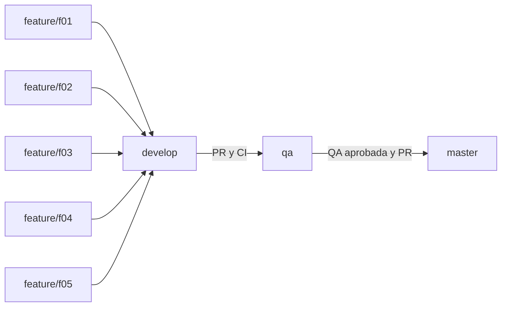

# Git Flow del backend Nathaly

Fecha de adopción: 11 de octubre de 2026. Flujo acordado: `feature/* -> develop -> qa -> master`. El repositorio es privado; cada integrante necesita acceso de escritura otorgado por el coordinador.

## Función de cada rama

| Rama | Contenido y responsable | Cómo recibe cambios |
| --- | --- | --- |
| `master` | Versión aprobada y referencia estable; coordinador de liberación. | PR desde `qa`; excepcionalmente un `hotfix/*` revisado. |
| `qa` | Candidato congelado para pruebas de integración y aceptación; responsable QA. | PR de promoción desde `develop`; correcciones `bugfix/qa-*` revisadas. |
| `develop` | Integración de las features del siguiente entregable; integrador. | PR desde `feature/*` o `bugfix/*`; sincronizaciones desde `qa`/`master`. |
| `feature/f0N-*` | Implementación de una tarea; desarrollador asignado. | Commits del responsable y sincronización con `develop`. |
| `main` | Referencia anterior conservada por compatibilidad histórica. | No usar para desarrollo, promociones ni nuevas liberaciones. |

`master` será la rama predeterminada. Estas ramas representan etapas de aprobación; crearlas no despliega servidores ni aprovisiona una BD de QA. Un despliegue futuro debe consumir el commit aprobado de cada rama con configuración privada independiente.



## 1. Clonar y preparar el entorno

Ejemplo para el Desarrollador 1, en PowerShell. Las cinco ramas asignadas están publicadas; cada persona sustituye el nombre por el suyo en [la tabla de asignación](requerimientos/README.md).

```powershell
git clone https://github.com/cvargas0503/nathaly-backend.git
cd nathaly-backend
git fetch origin --prune
git switch --track origin/develop
git pull --ff-only origin develop
git switch --track origin/feature/f01-ajustes-inventario
git merge origin/develop
npm ci
Copy-Item .env.example .env
```

Si la rama local ya existe, usar `git switch develop` o `git switch feature/f01-ajustes-inventario` sin `--track`. Completar `.env` con configuración de la BD de pruebas y clave JWT privada; consultar el README. No incluir ese archivo en commits.

Para una **feature nueva no publicada**, crearla desde el develop actualizado:

```powershell
git switch develop
git pull --ff-only origin develop
git switch -c feature/f06-nombre-descriptivo
```

Trabajar en la rama feature durante toda la implementación. No escribir commits de trabajo directamente en `develop`, `qa`, `master` o `main`. No usar las ramas de otro desarrollador como base ni mezclar features sin revisión.

## 2. Implementar y guardar avances

Antes de cada commit, revisar archivos y diferencias. Agregar explícitamente rutas relacionadas con la tarea, no usar `git add .` sin revisar qué incluirá.

```powershell
git status --short
git diff
git add src/modules/ajustes src/migrations/002_f01_ajustes.sql
git diff --cached
git diff --cached --check
git commit -m "feat(ajustes): register transactional inventory adjustments"
```

Los paths son ejemplos: agregar solo los archivos que existan y correspondan a la tarea. Guardar pruebas y documentación en commits separados cuando constituyan una unidad clara. El formato es `tipo(scope): descripción`; usar `feat`, `fix`, `refactor`, `test`, `docs`, `chore` o `ci`. No usar mensajes como `cambios`, `avance`, `final` ni juntar cinco features en un commit. Mantener cada commit compilable cuando sea posible; nunca publicar credenciales, dumps, uploads, `dist` o dependencias.

## 3. Sincronizar y publicar la feature

```powershell
git fetch origin --prune
git switch feature/f01-ajustes-inventario
git merge origin/develop
npm run typecheck
npm test
npm run build
git diff --check
git status --short
git push -u origin feature/f01-ajustes-inventario
```

Si el merge produce conflictos, resolver en la feature conservando las funcionalidades de ambas ramas, revisar los cambios, agregar los archivos resueltos y completar el commit del merge. Repetir las validaciones. Si no se sabe resolver, usar `git merge --abort` y coordinar con el integrador. No resolver sobrescribiendo todas las rutas compartidas ni con un force push. Si el push se rechaza porque la rama remota avanzó, hacer fetch, revisar e integrar esos cambios primero.

## 4. Abrir el PR hacia develop

En GitHub: **Pull requests -> New pull request**. Seleccionar **base: `develop`** y **compare: la rama feature asignada**. Ejemplo: https://github.com/cvargas0503/nathaly-backend/compare/develop...feature/f01-ajustes-inventario.

Completar la plantilla del repositorio con ID del requerimiento, problema resuelto, endpoints, migraciones, compatibilidad, pruebas y evidencia. Vincular el issue con `Closes #N` usando su número real. Solicitar revisión al compañero asignado; no basta abrir el PR. La aprobación y los checks deben corresponder al último commit después de correcciones.

El integrador comprueba alcance, contratos, permisos, transacciones, ausencia de secretos, migraciones y evidencias. Deben pasar `Validate API` y `Validate branch flow`; resolver todas las conversaciones y obtener al menos una aprobación de otra persona. Seleccionar **Create a merge commit** para conservar commits por feature y el punto de integración. No utilizar squash en este proyecto de evidencia académica ni merge manual directo a ramas de integración.

Después del merge, el desarrollador actualiza su develop y termina su trabajo:

```powershell
git switch develop
git pull --ff-only origin develop
git branch -d feature/f01-ajustes-inventario
git push origin --delete feature/f01-ajustes-inventario
```

Borrar únicamente la feature propia ya integrada. No usar `-D` para forzar eliminación de trabajo pendiente. Si `-d` se niega, verificar primero el PR y la inclusión de commits. Nunca borrar `develop`, `qa`, `master` o `main`.

## 5. Promover develop a QA

El integrador agrupa los PR de features aceptados en un candidato. Puede esperar los cinco para evidenciar una entrega conjunta. Abrir PR **base: `qa`**, **compare: `develop`**, con título `chore(release): promote <versión> to QA` y lista de features/issues incluidos, SHA de origen, migraciones y plan de pruebas. Solo mezclar cuando otro integrante haya revisado el candidato y el CI del PR pase.

Tras el merge, registrar el **SHA exacto de qa** evaluado en `docs/evidencias/QA-<version>.md`. Desde ese momento QA no recibe nuevas features ni promociones hasta resolver/aprobar ese candidato. `develop` puede seguir avanzando, sin que esos commits entren automáticamente en `qa`.

QA aplica migraciones en una BD de pruebas, ejecuta los criterios de aceptación de cada feature y el [checklist de QA](qa-checklist.md). No dar por aprobada la integración porque TypeScript compile. Registrar resultados, ambiente, fecha, responsables y defectos. El CI actual no levanta SQL Server; la evidencia de QA debe cubrirlo.

## 6. Corregir defectos encontrados en QA

Crear una corrección desde la rama QA del candidato:

```powershell
git fetch origin
git switch -c bugfix/qa-f01-stock origin/qa
# Corregir, hacer pruebas y commits fix/test.
git push -u origin bugfix/qa-f01-stock
```

Abrir PR `bugfix/qa-f01-stock -> qa`, revisarlo y mezclarlo. Después abrir PR de sincronización `qa -> develop` para no perder la corrección en el siguiente entregable. QA vuelve a ejecutar regresiones y registra el nuevo SHA; una aprobación sobre el SHA anterior queda obsoleta. Las nuevas funcionalidades continúan entrando por feature hacia develop, no por estas ramas de corrección.

## 7. Promover QA a master

Solo después de la aprobación documentada de QA sobre su último SHA, abrir PR **base: `master`**, **compare: `qa`**. Usar el [checklist de liberación](release-checklist.md), adjuntar evidencias y listar migraciones, riesgos y reversión. Aprobar y mezclar con **Create a merge commit**. No promover `develop` directamente a master.

El coordinador crea un tag anotado sobre el commit publicado en master, con una versión real previamente acordada:

```powershell
git fetch origin
git switch master
git pull --ff-only origin master
git tag -a v1.1.0 -m "release: validated backend features"
git push origin v1.1.0
```

`v1.1.0` es un ejemplo, no un tag ya creado. No reutilizar ni mover tags publicados. Abrir luego PR `master -> develop` si hace falta sincronizar la historia/correcciones; actualizar qa mediante la siguiente promoción revisada. Conservar el registro de la versión y sus issues/PRs. El flujo no hace despliegues automáticos.

## Hotfix excepcional

Un defecto urgente de una versión liberada se corrige en `hotfix/<ticket>-<descripcion>` creada desde `origin/master`. Entregar un PR a master con revisión, tests y evidencia específica; tras publicarlo, sincronizar por PR `master -> develop` y, si QA tiene un candidato activo, integrar la corrección mediante una `bugfix/qa-*` revisada y repetir sus pruebas. No introducir nuevas features con el nombre hotfix.

## Controles y evidencia

Configurar en GitHub protección de `develop`, `qa` y `master`: PR obligatorio, una aprobación ajena, descartar aprobaciones cuando cambian commits, requerir conversaciones resueltas, checks `Validate API` y `Validate branch flow`, y branch actualizado. Bloquear force pushes y eliminación; aplicar las reglas también a administradores. No activar historia lineal, porque esta estrategia utiliza merge commits. La rama heredada `main` debe permanecer sin desarrollo.

La protección debe comprobarse en Settings; este documento es una política y no sustituye una configuración efectiva. Si el plan de GitHub no permite proteger un repositorio privado, registrar esa limitación y aplicar revisión manual; el CI puede detectar un PR con destino incorrecto, pero no impide por sí solo un push directo.

Guardar como evidencia: cinco issues/requerimientos, ramas individuales, commits por funcionalidad, PRs y comentarios de revisión, ejecución del CI, evidencia de QA vinculada a SHA, PR de liberación y tag cuando exista. Las ramas iniciales se crean con el código existente; esta preparación de documentación/plantillas no equivale a haber implementado o aprobado las cinco features.

La puesta en marcha organizacional se integra una única vez por el coordinador mediante PRs de preparación, después de validar documentación y CI. Como todavía no se asignaron cuentas de los cinco integrantes, estos PRs iniciales no acreditan revisión por otra persona ni aceptación funcional de las features. La excepción termina al publicar esta preparación; las implementaciones posteriores siguen los controles de revisión y QA descritos arriba.
